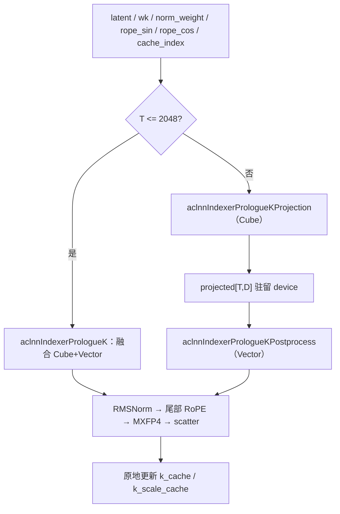

# indexer_prologue_k（ACLNN 交付）

- 融合实现：`op_kernel/indexer_prologue_k.py`
- 两阶段实现：`op_kernel/indexer_prologue_k_projection.py`、`op_kernel/indexer_prologue_k_postprocess.py`
- JIT 参考：`op_kernel/indexer_prologue_k_jit.py`
- 设计说明：`DESIGN.md`
- 测试：`tests/test_indexer_prologue_k.py`；golden：`tests/assets/indexer_prologue_k_golden.py`
- 结果与性能：`RESULTS.md`

## 1. 算子介绍

`indexer_prologue_k` 是 Indexer Key 前处理算子：对 `latent[T, H]` 做投影，再依次做 RMSNorm、
尾部 RoPE、block-32 MXFP4 量化，并按 `cache_index` 原地写入分页 `k_cache`。本目录提供
Ascend 950（arch 3510）上的 ACLNN 交付形态，同时保留原始 JIT 参考实现。

ACLNN 交付包含三个 OpDef：

- `IndexerPrologueK`：融合入口，Cube 投影 + MIX 屏障 + Vector 后处理；
- `IndexerPrologueKProjection`：Cube-only 投影；
- `IndexerPrologueKPostprocess`：Vector-only 后处理。

测试桥按 `T` 路由：

- `T <= 2048`：`aclnnIndexerPrologueK`（融合）；
- `T > 2048`：`aclnnIndexerPrologueKProjection` + `aclnnIndexerPrologueKPostprocess`，
  `projected[T, D]` 由测试桥在 device 上分配，两阶段之间无 host 同步。

两阶段路径与融合路径使用同一套投影/后处理语义，输出逐字节一致。

## 2. 计算公式

```text
projected = bf16(fp32(latent · wkᵀ))                # BF16 发布边界①，FP32 累加

inverse_rms = rsqrt(mean(projected²) + eps)
norm = bf16(projected · inverse_rms · γ)            # BF16 发布边界②

out[local even] = norm[l]·cos[l] - norm[l+1]·sin[l] # 尾部 Dr，local = t-(D-Dr)
out[local odd ] = norm[l]·cos[l] + norm[l-1]·sin[l] # BF16 发布边界③
```

MXFP4 量化（每 32 元素 group）：

```text
amax  = max(|x|)
safe  = max(amax, 6·2^-126)
raw   = safe · (1/6)
bits  = uint32(raw); exp = (bits>>23)&0xFF
exp  += (mantissa(bits) != 0)
scale = float32(exp<<23); scale_byte = uint8(exp)
n = |x| / scale; code = 7
if n<=5.0:6; <=3.5:5; <=2.5:4; <=1.75:3; <=1.25:2; <=0.75:1; <=0.25:0
if x < 0: code += 8
packed_byte = code[even] | (code[odd] << 4)
```

Cache 写入地址（`V = D/2`, `S = D/32`）：

```text
mode 0:  block = cr // C ; slot = cr % C
         data : k_cache[block, slot, 0, j]          (j = 0..V-1)
         scale: k_scale_cache[block, slot, 0, g]    (g = 0..S-1, 若传入)

mode 1:  raw = C*G ; block = cr // raw ; slot = cr % raw
         cg = slot // G ; sub = slot % G
         data : k_cache[block, cg, 0, sub*V + j]
         scale: k_cache[block, cg, 0, G*V + sub*S + g]
```

## 3. 计算流程



## 4. ACLNN 接口

融合入口：

```c
aclnnStatus aclnnIndexerPrologueKGetWorkspaceSize(
    const aclTensor *latent, const aclTensor *wk, const aclTensor *norm_weight,
    const aclTensor *rope_sin, const aclTensor *rope_cos, const aclTensor *cache_index,
    aclTensor *kCacheRef, aclTensor *kScaleCacheRef,
    int64_t storageMode, double normEps, int64_t combinedBlockSize,
    bool writeScaleCache,
    uint64_t *workspaceSize, aclOpExecutor **executor);
aclnnStatus aclnnIndexerPrologueK(
    void *workspace, uint64_t workspaceSize, aclOpExecutor *executor,
    aclrtStream stream);
```

两阶段入口：

- `aclnnIndexerPrologueKProjection`：`latent`、`wk` → `projected`；
- `aclnnIndexerPrologueKPostprocess`：`projected`、`norm_weight`、`rope_sin`、`rope_cos`、
  `cache_index`、`k_cache`、`k_scale_cache` → 原地 `k_cache` / `k_scale_cache`。

测试桥 `tests/aclnn_bridge/aclnn_bridge_indexer_prologue_k.cpp` 对上层暴露与 JIT 相同的
`indexer_prologue_k_wrapper(...)`，按 `T` 自动选择融合或两阶段路径。

输入：

| 名称 | 必选 | shape | dtype | 说明 |
|---|---|---|---|---|
| `latent` | 是 | `[T, H]` | bf16 | 输入 hidden states |
| `wk` | 是 | `[D, H]` | bf16 | 投影权重（ND，转置在 GM→L1 搬入时完成） |
| `norm_weight` | 是 | `[D]` | fp32 | RMSNorm γ |
| `rope_sin` / `rope_cos` | 是 | `[T, Dr]` | fp32 | 相邻偶奇 RoPE 系数 |
| `cache_index` | 是 | `[T]` | int64 | 目标逻辑行，`-1` 跳过 |
| `k_cache` | 是 | mode 0 `[B, C, 1, D/2]`；mode 1 `[B, C, 1, G(D/2 + D/32)]` | uint8 | 原地输出 |
| `k_scale_cache` | 是 | mode 0 `[B, C, 1, D/32]`；无 scale 时用 1 元素 dummy | uint8 | 由 `write_scale_cache` 控制写入 |

输出：`k_cache` 原 tensor；`k_cache`/`k_scale_cache` 为 ref 输出，shape 与输入相同。

## 5. 约束

- `T > 0`；`H > 0` 且 `H % 16 == 0`；`D >= 32` 且 `D % 32 == 0`；`0 < Dr <= D` 且 `Dr % 2 == 0`。
- `D <= 2048`。后处理按 `DimCap` 三档处理：`D <= 512` 用 512，`513..1024` 用 1024，
  `1025..2048` 用 2048；每档有独立 UB 布局与 `DYN_UB_SIZE`。
- `storage_mode ∈ {0, 1}`；mode 1 时 `combined_block_size = G > 0` 且 `C % G == 0`。
- `cache_index[t] == -1` 跳过该 token；重复目标以最后一个 token 为准；未触及字节保持不变。
- `latent`、`wk` 需连续；`k_cache` / `k_scale_cache` 需连续且 axis-0 无 stride。
- 测试桥在 `T > 2048` 时分配 `projected[T, D]`（bf16）；融合路径的 `projected` 由 ACLNN
  workspace 提供。
- 三处 BF16 发布边界（GEMM 输出、RMSNorm 输出、尾部 RoPE 输出）与参考实现严格一致。

## 6. 构建与测试

构建：

```bash
python3 build_ci.py --pkg-type run --ops indexer_prologue_k --soc ascend950 --no-torch-bindings
```

ACLNN 测试：

```bash
export ASCEND_CUSTOM_OPP_PATH=$PWD/build/ascend950/_CPack_Packages/makeself_staging/packages/vendors/pypto_gym
export LD_LIBRARY_PATH=$ASCEND_CUSTOM_OPP_PATH/op_api/lib:$LD_LIBRARY_PATH
python3 -m pytest ops/pro/deepseek_v4_1/indexer_prologue_k/tests \
  --mode aclnn --aclnn-lib-dir build/ascend950/tests -m 'not jit_only' -q
```

JIT 测试：

```bash
python3 -m pytest ops/pro/deepseek_v4_1/indexer_prologue_k/tests --mode jit -q
```

当前结果：ACLNN `60 passed`，JIT `60 passed`。融合/两阶段路径由
`test_fused_matches_two_kernel_dispatch`（T=4096）覆盖；`D=1024/2048` 为本地手测，
不进入 CI，结果见 `RESULTS.md`。
