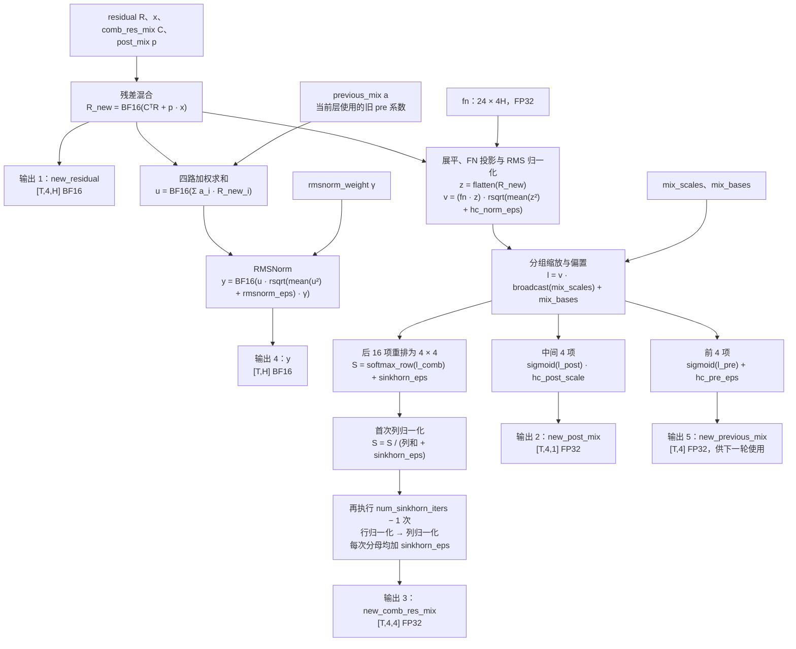

# MegaMhc（mega_mhc）

MegaMhc 是面向 Ascend 950 的融合算子，在一次调用中完成四路残差混合、
下一轮混合系数更新和当前层 RMSNorm 输出。支持通过
`aclnnMegaMhcGetWorkspaceSize` 和 `aclnnMegaMhc` 调用预编译二进制，
运行时无需 JIT。

## 计算与接口

融合残差混合、下一轮系数更新和 RMSNorm。混合后的残差和旧 pre 系数加权的
中间向量各进行一次 BF16 舍入；当前层输出使用旧 pre 系数。FN 输入保持 FP32
且只读，保留原生范围检测和 Vector 回退路径。每次非空调用启动一个 MIX kernel。

| 输入（顺序固定） | 形状        | dtype |
| ---------------- | ----------- | ----- |
| x                | `[T,H]`   | BF16  |
| residual         | `[T,4,H]` | BF16  |
| previous_mix     | `[T,4]`   | FP32  |
| post_mix         | `[T,4,1]` | FP32  |
| comb_res_mix     | `[T,4,4]` | FP32  |
| fn               | `[24,4H]` | FP32  |
| mix_scales       | `[3]`     | FP32  |
| mix_bases        | `[24]`    | FP32  |
| rmsnorm_weight   | `[H]`     | BF16  |

五个输出依次为 `new_residual [T,4,H] BF16`、`new_post_mix [T,4,1] FP32`、
`new_comb_res_mix [T,4,4] FP32`、`y [T,H] BF16`、`new_previous_mix [T,4] FP32`。
所有张量均为同设备、连续 ND；输入可以只读共享，输出和 workspace 必须互不重叠，
并与输入分离。Torch 绑定在进入异步队列前检查所有输入和输出的真实存储格式，
拒绝 NZ 等非 ND 存储，不做隐式格式转换；`is_contiguous()` 为真也不代表格式是 ND。
`T >= 0`，`H ∈ {1024,2048,3072,4096,5120,6144,7168}`。
每个 H shard 使用一个常驻 AIC 组，设备可用 AIC 数须至少为 `H/256`。

| ACLNN 属性（位于输入和输出之间） | 默认值 | 约束                        |
| -------------------------------- | ------ | --------------------------- |
| hc_norm_eps                      | 2e-5   | 有限、正                    |
| hc_pre_eps                       | 3e-4   | 有限、非负                  |
| hc_post_scale                    | 1.25   | 有限、非负                  |
| sinkhorn_eps                     | 2e-6   | 有限、非负                  |
| num_sinkhorn_iters               | 10     | 整数 1..65535               |
| rmsnorm_eps                      | 7e-6   | 有限、正                    |
| batch                            | 0      | 0 自动选择；16 强制 batch16 |

ACLNN 浮点属性以 `double` 传入，host tiling 按 FP32 使用。
自动选择在 `H=7168,T>=4096` 时使用内部 batch8/J27，其他形状使用 batch16
（H7168/J7，其余 H/J8）。公共 batch8 override 不支持。

## 数学计算流

以下计算对每个 token 独立进行。记输入残差为
$R\in\mathbb{R}^{4\times H}$，残差混合矩阵为 $C$，
旧 pre 系数为 $a$，post 系数为 $p$，RMSNorm 权重为 $\gamma$。
`BF16` 表示舍入到 BF16；后续计算读取其舍入后的数值并转为 FP32。



残差混合的索引定义为：

$$
R'_{t,j,h}=\operatorname{BF16}\!\left(
\sum_{i=0}^{3}C_{t,i,j}R_{t,i,h}+p_{t,j}x_{t,h}\right),
\qquad
u_{t,h}=\operatorname{BF16}\!\left(\sum_{j=0}^{3}a_{t,j}R'_{t,j,h}\right).
$$

投影得到的 24 项按 `pre[0:4]`、`post[4:8]`、`comb[8:24]` 分组，
三组分别使用 `mix_scales[0]`、`mix_scales[1]`、`mix_scales[2]`。
图中的行归一化沿矩阵最后一维求和，列归一化沿倒数第二维求和。
两个分支均读取已经舍入到 BF16 的 `R_new`；当前层 `y` 始终使用输入的
`previous_mix`，更新后的 `new_previous_mix` 供下一轮调用使用。

## 二进制构建与调用

在仓库根目录、已配置 CANN 和 PyPTO-pro 的环境执行：

```bash
python3 build_ci.py --pkg-type run --ops mega_mhc --soc ascend950
bash build_out/run/ascend950/cann-950-pypto_gym_*.run \
  --install-path="$PWD/build_out/run/ascend950"
source build_out/run/ascend950/vendors/pypto_gym/bin/set_env.bash
```

安装后 C++ 使用 `op_api/include/aclnnop/aclnn_mega_mhc.h`：

```cpp
uint64_t workspaceSize = 0;
aclOpExecutor *executor = nullptr;
auto ret = aclnnMegaMhcGetWorkspaceSize(
    x, residual, previousMix, postMix, combResMix, fn, mixScales, mixBases,
    rmsnormWeight, 2e-5, 3e-4, 1.25, 2e-6, 10, 7e-6, 0,
    newResidual, newPostMix, newCombResMix, y, newPreviousMix,
    &workspaceSize, &executor);
// 检查 ret；按 workspaceSize 在设备上分配 workspace。
ret = aclnnMegaMhc(workspace, workspaceSize, executor, stream);
// 检查 ret；异步完成前保持输入、输出、workspace 存活。
```

Q、inverse RMS 和 range flags 被打包到同一 ACLNN workspace，分段按 512 字节
对齐，大小由 GetWorkspaceSize 返回。不同在途调用使用独立 workspace。

`op_kernel/mega_mhc.py` 提供开发用 JIT wrapper，支持上述九输入、标量和
`batch=None/16`；输出由 wrapper 内部申请。开发用 `allocate_workspace(x, batch=...)` 返回
单个 UINT8 张量（交付 ABI），其容量和偏移由 `select_config` 给出。
T=0 时 Python wrapper 和测试桥直接返回空输出。

## Torch 接口

`.run` 默认同时交付正式 Torch 绑定；仅需 ACLNN 接口时可传入 `--no-torch-bindings`：

```bash
python3 build_ci.py --pkg-type run --ops mega_mhc --soc ascend950
bash build_out/run/ascend950/cann-950-pypto_gym_*.run --install-path="$ASCEND_HOME_PATH/opp"
```

当前终端已加载目标 CANN 基础环境时，安装后即可直接导入，无需额外 source vendor
脚本。Python 入口自动登记到 CANN 的 `python/site-packages`，ACLNN 库按绑定库的
相对路径加载。安装到非 CANN 的独立目录时，仍可使用其 vendor `set_env.bash`。

```python
import torch
import pypto_gym

result = pypto_gym.mega_mhc(*inputs)  # 上表顺序的九个同设备 NPU 输入
# 直接使用 torch.ops 前先显式加载绑定：
pypto_gym.load()
result = torch.ops.pypto_gym.mega_mhc(*inputs, batch=0)
```

`pypto_gym.mega_mhc` 只提供返回值形式，五个输出由绑定内部申请。

`import pypto_gym` 惰性加载，不导入 torch/torch_npu；访问 `pypto_gym.mega_mhc` 或
调用 `pypto_gym.load()` 时才加载已安装的绑定库。

Python 入口的 `batch=None` 对应 dispatcher 的 `batch=0`。六个标量参数的名称和
默认值与上表一致。执行路径为 Torch dispatcher → 编译好的 C++ 绑定 → ACLNN
→ 预编译 kernel；绑定本身也随包预编译，调用时无需 PyPTO JIT 或 C++ 编译。
绑定支持 Meta/FakeTensor 输出推导；当前提供 forward 计算，不提供 backward。
部署时需使用与构建环境兼容的 Python、torch、torch_npu 和 CANN。

## 测试

数值测试看护完整算子的典型 shape 和边界，共 **25 项**。每项执行一次完整算子，
使用固定默认标量；仅最后一项显式指定 `batch=16`。
用例表为每项固定选择一个入口：12 项直接调用 `pypto_gym.mega_mhc`，
另 13 项直接调用 `torch.ops.pypto_gym.mega_mhc`，总计仍为 25 项。
输出由绑定内部申请，测试不预分配输出。

另有 **1 项格式边界用例**，通过 `torch.ops.pypto_gym.mega_mhc` 传入 NZ 输入，
验证逻辑连续但物理存储不为 ND 时会在调用线程直接报错。

| 分类             | 数量 | T、H 与覆盖目的                                                                     |
| ---------------- | ---- | ----------------------------------------------------------------------------------- |
| 典型 shape       | 8    | `(128,1024/2048/3072/5120/6144)`、`(96,5120)`、`(200,4096)`、`(1025,7168)`；覆盖全部七种 H |
| 空输入、单 token | 2    | `(0,1024)`、`(1,7168)`                                                          |
| 小批次尾部       | 3    | `H=4096,T=31/32/33`；不足、恰好和超过一个 32-token 作业                           |
| 分块边界         | 6    | `H=4096,T=255/256/257`；`H=7168,T=223/224/225`，覆盖两种 batch16 分块容量的边界 |
| 自动配置切换     | 3    | `H=7168,T=4095/4096/4097`；切换前、切换点和切换后的尾部                           |
| 数值边界         | 2    | `(1,1024)` 的零输入、`(5,3072)` 的近零输入；检查 RMS 退化场景                   |
| 强制 batch16     | 1    | `(4096,7168,batch=16)`；覆盖大 shape 的显式配置                                   |

25 项数值用例都比较五个输出与独立 CPU golden，保留两次 BF16 舍入和原有精度容差。
同时检查只读输入不变，以及输入两端的 guard。测试中不做预热、重复调用、
状态串联、参数组合扩展或 Torch 框架专项检查。

将带 Torch 绑定的 `.run` 安装到已加载基础环境的 CANN 后执行：

```bash
pytest ops/pro/deepseek_v4_1/mega_mhc/tests -q
```

测试文件直接导入安装包 `pypto_gym` 并调用上述接口，调用入口由用例表固定指定，
不受仓级 `--mode` 参数控制。运行时需要已安装的 Torch 二进制绑定。
