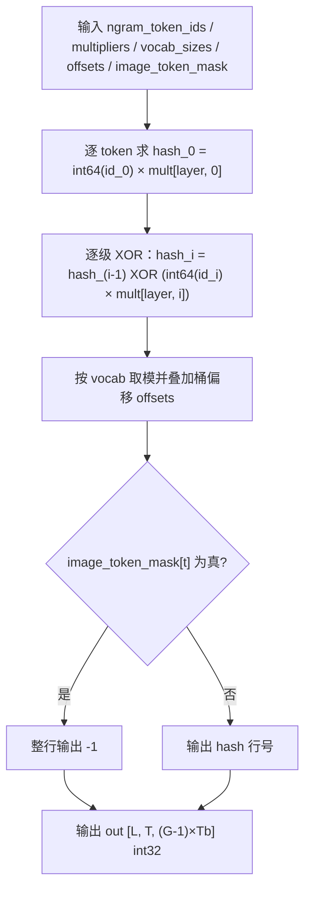

# engram_hash（PyPTO-Pro）

- 实现：`op_kernel/engram_hash.py`
- 设计说明：`DESIGN.md`
- 测试：`tests/test_engram_hash.py`；golden：`tests/assets/engram_hash_golden.py`
- 结果与性能：`RESULT.md`

## 1. 算子介绍

engram_hash 是 Engram n-gram 哈希算子：输入每个 token 的 n-gram token id，按层与 n-gram
位置做 XOR 哈希，再按每张 embedding 表的词表大小取模、叠加桶偏移，得到记忆表的行号；
图像 token 的输出行填充为 -1。基于 `pypto_pro` DSL 在昇腾 NPU 上实现，运行于
Ascend 950（arch 3510）。

DeepSeek V4.1 的规格为 `L=2`、`Tb=8`、`G=4`，输出 `[2, T, 24]`；层数、头数与 `G` 均可配置。

## 2. 计算公式

对每个 token `t`、每个 n-gram layer：

```text
hash_0 = int64(ngram_token_ids[t, 0]) * multipliers[layer, 0]
hash_i = hash_{i-1} XOR (int64(ngram_token_ids[t, i]) * multipliers[layer, i]),  i = 1..G-1

out[layer, t, (i-1)*Tb + tb] = hash_i % vocab_sizes[layer, i-1, tb]
                               + offsets[layer, (i-1)*Tb + tb]
out[layer, t, :] = -1                                   当 image_token_mask[t] 为真
```

哈希为 int64 环绕语义：token id 由 int32 提升到 int64 后与 int64 乘子相乘，再逐级 XOR。
取模采用向下取整语义（与 torch 的 `%` 一致）；设备侧的截断取模由负余数加一次除数修正，
对任意 int64 输入与参考实现逐位一致。

## 3. 计算流程



## 4. 入参说明

```python
import sys
sys.path.insert(0, "<...>/engram_hash/op_kernel")
from engram_hash import (
    engram_hash,
    make_offsets,
)

offsets = make_offsets(vocab_sizes)               # [L, (G-1)*Tb] int32，exclusive prefix-sum
out = engram_hash(ngram_token_ids, multipliers, vocab_sizes, offsets, image_token_mask=None)
```

输入：

| 名称 | 必选 | shape | dtype | 说明 |
|---|---|---|---|---|
| `ngram_token_ids` | 是 | `[T, G]` | int32 | 每个 token 的 n-gram token id |
| `multipliers` | 是 | `[L, G]` | int64 | 每层、每个 n-gram 位置的哈希乘子 |
| `vocab_sizes` | 是 | `[L, G-1, Tb]` | int32 | 每层、每个 n-gram 位置、每张表的词表大小 |
| `offsets` | 是 | `[L, (G-1)*Tb]` | int32 | 由 `make_offsets` 生成，也可由调用方自备 |
| `image_token_mask` | 否 | `[T]` | bool / uint8 | `True` 的 token 输出整行为 -1；`None` 等价全 False |

输出：

| 名称 | shape | dtype | 说明 |
|---|---|---|---|
| `out` | `[L, T, (G-1)*Tb]` | int32 | embedding 行号 |

## 5. 约束

- `T ≥ 0`；`L > 0`；`G ≥ 2`；`Tb > 0`。
- 所有输入张量位于同一 device；`ngram_token_ids`、`multipliers`、`vocab_sizes`、`offsets` 需连续。
- `image_token_mask` 长度必须等于 `T`。
- 参数 rank、dtype、shape 或 device 不符合契约时直接抛出 `ValueError`，不进行隐式类型转换。
- 调用方需保证 `token_id × multiplier` 不溢出 int64（与参考实现契约一致）。
- 内核按 `(L, G, Tb, T, mask 形态)` 编译期专门化；新的组合触发一次编译，同一组合的重复调用命中缓存。
- `output` 为 int32：`hash % vocab` 小于 `vocab ≤ 2^31`，叠加 int32 偏移后仍在 int32 范围内。

## 6. 测试

```bash
python3 -m pytest ops/pypto_pro/deepseek_v4_1/engram_hash/tests/test_engram_hash.py -q

# 性能采集（kernel 时间口径，刷 L2；由 msprof 解析）
ENGRAM_HASH_BENCH=1 ENGRAM_HASH_FLUSH_MB=256 python3 -m pytest \
  ops/pypto_pro/deepseek_v4_1/engram_hash/tests/test_engram_hash.py -q -k benchmark -s
```

用例标记 `@pytest.mark.soc("950")`；无 NPU 环境下 NPU 用例自动跳过（`make_offsets` 的 CPU 用例
始终运行）。输出为整型，与 `tests/assets/engram_hash_golden.py`（纯 torch 参考）用 `torch.equal`
逐位比较，不设容差；覆盖尾块、整块、多块、mask 三态、负乘子、`T=0` 与非法输入等路径。
