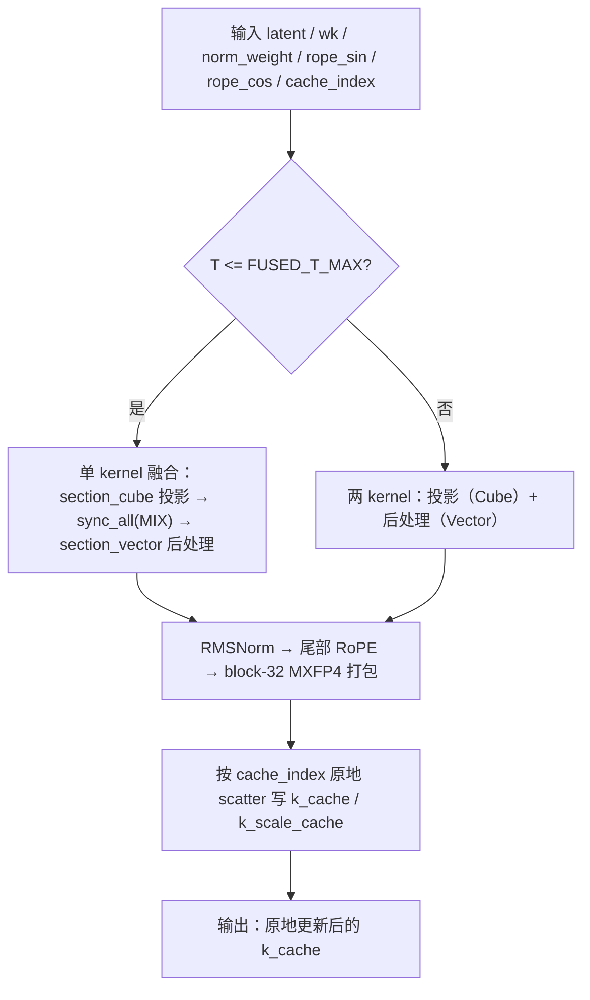

# indexer_prologue_k（PyPTO-Pro）

- 实现：`op_kernel/indexer_prologue_k.py`
- 设计说明：`DESIGN.md`
- 测试：`tests/test_indexer_prologue_k.py`；golden：`tests/assets/indexer_prologue_k_golden.py`
- 结果与性能：`RESULT.md`

## 1. 算子介绍

indexer_prologue_k 是 Indexer Key 前处理算子：对 `latent[T, H]` 做投影，再依次做 RMSNorm、
尾部 RoPE、block-32 MXFP4 量化，并按 `cache_index` 原地写入分页 `k_cache`。基于
`pypto_pro` DSL 在昇腾 NPU 上实现，运行于 Ascend 950（arch 3510）。

下发形态按 token 数 `T` 派发（`FUSED_T_MAX` 默认 2048）：

- `T <= FUSED_T_MAX`：**单 kernel 融合**（`make_fused_kernel`）——同一 `@pl.jit` 内
  `section_cube()` 投影 → `sync_all(MIX)` 全局屏障 → `section_vector()` 后处理，
  省一次 kernel 下发的固定开销（小/中 T 约 1.3–2.1×）。
- `T > FUSED_T_MAX`：**两 kernel**——`indexer_projection_kernel`（Cube）+
  `indexer_postprocess_kernel`（Vector），大 T 时融合的 MIX 屏障无收益甚至略慢。

两条路径由同一套后处理逻辑生成，输出逐字节一致。

## 2. 计算公式

```text
projected = bf16(fp32(latent · wkᵀ))                # BF16 发布边界①，FP32 累加

inverse_rms = rsqrt(mean(projected²) + eps)
norm = bf16(projected · inverse_rms · γ)            # BF16 发布边界②

out[local even] = norm[l]·cos[l] - norm[l+1]·sin[l] # 尾部 Dr，local = t-(D-Dr)
out[local odd ] = norm[l]·cos[l] + norm[l-1]·sin[l] # BF16 发布边界③
```

MXFP4 量化（每 32 元素 group）：

```text
amax  = max(|x|)
safe  = max(amax, 6·2^-126)
raw   = safe · (1/6)                 # 倒数乘（非除法）
bits  = uint32(raw); exp = (bits>>23)&0xFF
exp  += (mantissa(bits) != 0)        # >= raw 的下一个 2 的幂
scale = float32(exp<<23); scale_byte = uint8(exp)
n = |x| / scale; code = 7
if n<=5.0:6; <=3.5:5; <=2.5:4; <=1.75:3; <=1.25:2; <=0.75:1; <=0.25:0
if x < 0: code += 8
packed_byte = code[even] | (code[odd] << 4)
```

Cache 写入地址（`V = D/2`, `S = D/32`）：

```text
mode 0:  block = cr // C ; slot = cr % C
         data : k_cache[block, slot, 0, j]          (j = 0..V-1)
         scale: k_scale_cache[block, slot, 0, g]    (g = 0..S-1, 若传入)

mode 1:  raw = C*G ; block = cr // raw ; slot = cr % raw
         cg = slot // G ; sub = slot % G
         data : k_cache[block, cg, 0, sub*V + j]
         scale: k_cache[block, cg, 0, G*V + sub*S + g]
```

## 3. 计算流程



中间张量 `projected[T, D]` 驻留 device，两阶段之间无 host 同步。

## 4. 入参说明

```python
import sys
sys.path.insert(0, "<...>/indexer_prologue_k/op_kernel")
from indexer_prologue_k import indexer_prologue_k_wrapper

result = indexer_prologue_k_wrapper(
    latent, wk, norm_weight, rope_sin, rope_cos, k_cache,
    k_scale_cache=None,          # mode 0 可选
    cache_index=cache_index,     # keyword-only，INT64，-1 跳过
    storage_mode=0,              # 0: 数据/scale 分离；1: combined
    norm_eps=1e-6,
    combined_block_size=-1,      # mode 1 时为 G
)
```

原地更新 `k_cache`（及可选 `k_scale_cache`）并返回同一个 `k_cache`。

输入：

| 名称 | 必选 | shape | dtype | 说明 |
|---|---|---|---|---|
| `latent` | 是 | `[T, H]` | bf16 | 输入 hidden states |
| `wk` | 是 | `[D, H]` | bf16 | 投影权重（ND，转置在 GM→L1 搬入时完成） |
| `norm_weight` | 是 | `[D]` | fp32 | RMSNorm γ |
| `rope_sin` / `rope_cos` | 是 | `[T, Dr]` | fp32 | 相邻偶奇 RoPE 系数 |
| `cache_index` | 是 | `[T]` | int64 | 目标逻辑行，`-1` 跳过 |
| `k_cache` | 是 | mode 0 `[B, C, 1, D/2]`；mode 1 `[B, C, 1, G(D/2 + D/32)]` | uint8 | 原地输出 |
| `k_scale_cache` | 否 | mode 0 `[B, C, 1, D/32]` | uint8 | 原地输出，仅 mode 0 且传入时写入 |

输出：

| 名称 | shape | dtype | 说明 |
|---|---|---|---|
| 返回 | 同 `k_cache` | uint8 | 传入的同一个 `k_cache`（原地更新） |

## 5. 约束

- `T > 0`；`H > 0` 且 `H % 16 == 0`；`D >= 32` 且 `D % 32 == 0`；`0 < Dr <= D` 且 `Dr % 2 == 0`。
- `storage_mode ∈ {0, 1}`；mode 1 时 `combined_block_size = G > 0` 且 `C % G == 0`。
- `cache_index[t] == -1` 跳过该 token；重复目标以最后一个 token 为准；未触及字节保持不变。
- `latent`、`wk` 需连续；`k_cache` / `k_scale_cache` 需连续且 axis-0 无 stride。
- 后处理按 `(T, D, Dr, storage_mode, G, write_scale, cache_blocks, cache_slots, 启动核数)` 编译期专门化
  （SIMT 入口要求静态 shape）；线程数 = `D`，要求 `D` 为 32 的倍数且 `D <= 2048`。
- 投影按 L1 tile 形状类别（`NMode` / `KMode`）专门化；`(H, D)` 与 `T` 运行时读取，
  同一类别下一份二进制服务任意形状。
- 三处 BF16 发布边界（GEMM 输出、RMSNorm 输出、尾部 RoPE 输出）与参考实现严格一致。

## 6. 测试

```bash
python3 -m pytest ops/pypto_pro/deepseek_v4_1/indexer_prologue_k/tests/test_indexer_prologue_k.py -q
```

无需 NPU 的 CPU 用例（golden / MXFP4 / cache ABI）始终可跑；NPU 端到端用例在无设备时跳过。
NPU 输出与 `tests/assets/indexer_prologue_k_golden.py`（bit-exact CPU 参考）用 `torch.equal`
逐字节比较，`k_cache` 与 `k_scale_cache` 均要求完全一致；覆盖尾块、形状回退、RoPE 短尾/全尾、
重复与乱序 index、未命中哨兵、mode 1 组合行，以及融合与两 kernel 两条路径逐字节一致。
